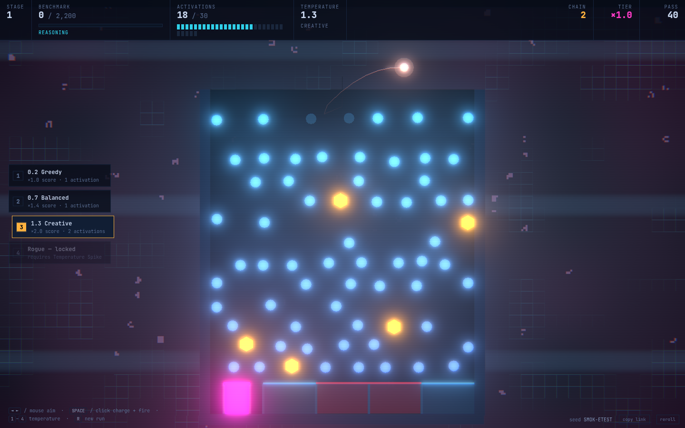

# rogue/acc

A browser-based neural pachinko roguelike. The machine is a large language
model: tokens cascade through weights, you set the sampling temperature before
every forward pass, and each stage is a benchmark you have to exceed before
your activation pool runs dry.

Three.js · TypeScript · Vite · Rapier2D · pure client-side, no backend.



```bash
npm install
npm run dev          # http://localhost:5173
```

| Script | What it does |
| --- | --- |
| `npm run dev` | Dev server with HMR |
| `npm run build` | Typecheck, then production bundle into `dist/` |
| `npm run typecheck` | `tsc --noEmit` |
| `npm run sim` | **Headless balance sweep** — see [Tuning](#tuning) |
| `npm run smoke` | Build, then drive the real game in headless Chromium |

---

## How it plays

Aim with the mouse or `◄ ►`, hold `SPACE` (or click) to charge, release to fire
a token into the network. It cascades through the weights, each distinct weight
it strikes scores, and the multiplier climbs the longer the cascade runs. Beat
the stage's benchmark target before you run out of activations.

| Key | Action |
| --- | --- |
| `◄ ►` / `A D` / mouse | Aim |
| `SPACE` / click | Charge and fire (auto-fires at full charge) |
| `1`–`4` | Select sampling temperature |
| `E` | Agentic Override — redirect a token mid-flight (if unlocked) |
| `R` | New run |
| `Enter` / `1`–`3` | Operate any overlay without the mouse |

---

## The one design decision worth explaining

**There is no Frenzy meter, and that is deliberate.**

The original brief called for a Frenzy system that builds during dense cascades
and multiplies score. The problem is not that it would be pure upside — that is
fixable with numbers. The problem is that **a meter which fills during a cascade
is something the player watches, not something the player decides.** Your entire
input surface in a pachinko game is aim, charge, and fire. Adding a bar that
fills on its own does not add a decision; it adds an animation.

So temperature replaces it. You choose it *before* each pass:

| Tier | Bounce | Score | Cost |
| --- | --- | --- | --- |
| 0.2 Greedy | ×0.8 | ×1.0 | 1 activation |
| 0.7 Balanced | ×1.0 | ×1.4 | 1 activation |
| 1.3 Creative | ×1.25 | ×2.0 | 2 activations |
| 2.0 Rogue *(locked)* | ×1.5 | ×3.0 | 3 activations |

Higher temperature makes tokens genuinely bouncier — they strike more weights,
with far more variance, and get flung into dead neurons more often. It costs
more activations, paid from the same pool that limits the whole run. That is a
real bet, made every single pass, with the escalating glitch-and-bloom payoff
the brief wanted. And "temperature" is *literally* a pre-generation sampling
parameter, so the metaphor got more correct rather than less.

The measured payoff, from `npm run sim`:

```
tier        cost   p10     p50     p90     max
0.2 Greedy     1      70     155     333    1200
0.7 Balanced   1     140     277     945    2450
1.3 Creative   2      40     420    1750    4450
2.0 Rogue      3      30     668    2145    9640
```

Balanced returns **277 per activation**; Rogue returns **223**. The hot tiers
are a worse bet on expectation and a far better one on ceiling — exactly the
shape a gamble should have. Note the p10 column: Rogue's floor is *lower* than
Greedy's, because a wild token can whiff entirely.

---

## Where the balance values live

**`src/config/balance.ts` is the only file with gameplay constants in it.**
Nothing else in the codebase contains a magic number you would want to tune.

The three values that matter most, and the invariant tying them together:

```
BASE_PIN_VALUE      10      the unit of all scoring
BENCHMARK_GROWTH    1.4     how fast stage targets escalate
upgrade strength    ~+40%   how fast player power escalates
```

Targets grow 1.4× per stage across 8 stages, and the player gets 7 upgrade
picks, so they must get ~10.5× stronger (1.4⁷). **If you change
`STAGES.growth`, upgrade strength in `src/config/upgrades.ts` has to move with
it** or the back half of the run becomes unwinnable. This coupling is the single
most important invariant in the game and it is commented at both ends.

Other dials worth knowing:

| Where | What |
| --- | --- |
| `STAGES.baseTarget` | Stage 1 target (2,200). Calibrated so a stage costs ~8 passes, which exactly matches the +8 clear refund — a competently played stage breaks even on activations. |
| `ECONOMY` | One pool for the whole run, not per stage. Start 20, cap 30, +8 per clear, +3 for a 50% overshoot. |
| `ORB.restitution` | Base bounciness at Balanced. The main dial for how lively the whole board feels. Colliders combine with `CoefficientCombineRule.Max`, so this × the tier's `bounce` is what actually governs it. |
| `SCORE.tierMultipliers` / `tierThresholdSteps` | The multiplier ladder. Thresholds are multiples of `pinsPerTier` so the Residual Amplifier upgrade compresses the whole ladder without needing a second table. |
| `BOARDGEN` | Pin counts, layer counts, pocket counts, placement jitter. |
| `VALIDATOR` | Playability thresholds. See below. |
| `VISUAL` / `COLORS` | Bloom, glitch ceiling, camera padding, palette. |

Adding an upgrade means appending one entry to `UPGRADES` in
`src/config/upgrades.ts`. Every upgrade is data plus one `apply(mods)` function
that mutates a flat `Mods` bag; nothing in the sim or render layer knows any
individual upgrade exists.

---

## Tuning

`npm run sim` runs the real generator, the real validator, the real physics and
the real scoring code with no renderer attached, then reports the distributions
that actually decide whether the numbers work.

```bash
npm run sim          # 24 seeds
npm run sim -- 60    # 60 seeds
```

This exists because the acceptance criteria for this game are things like
"cascades feel energetic" and "boards stay playable", which cannot be eyeballed
reliably. It paid for itself immediately: the first run showed a random-aim bot
winning **87.5%** of games and clearing stages in 3 passes instead of 8. The
cause was a single line — attention-head hits were advancing a full multiplier
tier each, so two heads on a mediocre 11-weight cascade reached the top ×3 tier.
After fixing that and recalibrating targets against measured output:

```
win rate            16.7%  (unskilled baseline)
passes per stage    p50 7
median cascade      11 weights
board fallbacks     0%
```

Read it as: an unskilled random-aim bot should win *rarely but not never*. If a
bot that does not aim clears most runs, the game has no skill ceiling.

The sim layer imports nothing from Three.js or the DOM, which is what makes the
harness possible. **Keep it that way.**

---

## Procedural boards

Each stage is a new model configuration, built layer by layer — the theme's
"layers" are literal. Each layer picks a placement pattern (`lattice`, `offset`,
`funnel`, `arc`, `cluster`, `sparse`, `colonnade`), so a board reads as a stack
of distinct structures rather than uniform noise.

One hard constraint throughout: no two weights closer than `PIN.minSpacing`,
derived from orb and pin radii so a token can always physically pass between
neighbours. Violate it and you get invisible walls that silently eat cascades.

### The validator is a crash guard, not a design system

`src/sim/validator.ts` does not try to make boards fun — the generator is
responsible for that. It only rejects boards that are *actively broken*: ones
where tokens wedge between weights forever, or where a drop falls through a gap
and strikes almost nothing.

It fires 24 probe drops across the full aim cone into a throwaway physics world
and measures median cascade length, settle rate, and max token lifetime.
Candidates that fail are regenerated, up to 10 attempts, then it falls back to a
handcrafted reference board. In the current sweep it accepts in **1.5 attempts
on average and has never needed the fallback** — but one unplayable stage in a
run is worse than any amount of sameness, so the guard stays.

The verdict is surfaced on the stage-intro screen, which doubles as flavour: the
lab checked the configuration before letting you run tokens through it.

---

## Seeds

Every random decision in gameplay flows through a seeded `sfc32` stream.
**`Math.random()` is banned from gameplay code** — the only exceptions are
minting a new seed and cosmetic popup jitter.

Streams are derived, not shared: `deriveRng(seed, 'board', 4)` gives stage 4 the
same board no matter what you picked on stages 1–3, and no matter how many times
the RNG was pulled elsewhere. That independence is what makes a seed meaningful.

The seed is in the URL (`?seed=XXXX-XXXX`), shown bottom-right, and **copy
link** puts a shareable URL on your clipboard. **Retry this seed** on the
game-over screen replays the identical run.

This is also why the physics engine is Rapier rather than cannon-es: Rapier is
deterministic for a given build, so a seed reproduces cascades and not merely
layouts. cannon-es makes no such guarantee.

---

## Architecture

```
src/
  config/
    balance.ts      ALL gameplay constants. The only tuning surface.
    upgrades.ts     16 upgrades across 4 archetypes, pure data + apply(mods)
  core/
    rng.ts          seeded sfc32, derived streams, seed minting
    state.ts        run model + phase machine. Knows no Three.js, no Rapier, no DOM.
    game.ts         orchestration: owns physics, views, HUD, frame loop
  sim/              HEADLESS — imports nothing from Three.js or the DOM
    board.ts        inert board description (geometry + metadata)
    boardgen.ts     procedural generation, layer patterns, fallback board
    validator.ts    headless playability probing
    physics.ts      Rapier2D wrapper, fixed timestep, velocity clamping
    launcher.ts     aim, charge, temperature selection, trajectory preview
    scoring.ts      multiplier ladder, pass accumulation, spike resolution
  render/
    scene.ts        renderer, ortho camera, bloom + glitch post chain
    boardView.ts    instanced weight meshes, rails, pockets
    orbView.ts      tokens, trails, launcher visuals
    background.ts   procedural circuit/glyph substrate shader
  ui/
    hud.ts          DOM heads-up display
    overlays.ts     stage intro / clear / upgrade / run end sheets
  flavor/
    text.ts         all player-facing copy, seeded selection
tools/
  simulate.ts       headless balance harness
  smoke.mjs         real-browser runtime test
```

Responsibility split, so each file stays readable:

- `state.ts` decides the **rules** — can I afford this, did I clear?
- `scoring.ts` decides the **points** — what is this weight worth right now?
- `physics.ts` decides the **motion** — where did the token go?
- `game.ts` decides the **order** — what happens next, and who gets told?

### Two invariants the physics layer enforces

1. **Fixed timestep.** The world is only ever stepped with `PHYSICS.dt`.
   Stepping with frame delta destroys determinism and makes bounce tuning
   framerate-dependent.
2. **Velocity clamp every step.** Small fast tokens against roundish weights is
   the classic tunnelling setup. CCD is on too, but the clamp is the real
   insurance — and it keeps cascades readable instead of a blur.

Weights are also deliberately *larger* than tokens (`0.3` vs `0.25` radius),
which both prevents tunnelling and makes every bounce read clearly.

### Pass resolution

A forward pass is not over when you release the launcher — it is over when the
last of its tokens leaves the board, because a benchmark spike retroactively
multiplies everything banked during that pass. Score is held uncommitted in
`Pass` until `orbCount` hits zero.

A weight scores **once per pass, not once per contact**. Without that, a token
rattling in a pocket of three weights farms them forever and the multiplier
ladder becomes meaningless. "Chain" in the HUD is therefore the count of
*distinct* weights struck.

---

## Testing

`npm run smoke` builds the game, serves `dist/`, boots it in headless Chromium,
drives real keyboard and pointer input through several passes, and fails on any
console error or page exception.

This is not ceremony. Typechecking and bundling prove nothing about a WebGL app,
and the smoke test caught two bugs that both passed `tsc` and `vite build`
cleanly:

- `active` is a **reserved word in GLSL ES**, so the entire glitch pass silently
  failed to compile.
- `vertexColors: true` on an `InstancedMesh` material makes Three look for a
  per-vertex `color` attribute that `CircleGeometry` does not have, so **every
  weight on the board rendered black**. Instance colours come from the separate
  `instanceColor` attribute and need no such flag.

Set `ACTION_SHOT=1` to also write `tools/board.png` and `tools/action.png`.

---

## Scope

**In:** full playable run loop, 8 stages, procedural boards with validation,
temperature system, activation economy, benchmark objectives, 16 upgrades,
seeded determinism, themed placeholder visuals, HUD, headless balance harness,
browser smoke test.

**Out:** meta-progression between runs, audio, boss models, real benchmark data
or API calls.

### Known rough edges

- **The bundle is ~4 MB.** `@dimforge/rapier2d-compat` inlines its WebAssembly
  as base64, which is the price of not needing a wasm loader plugin. Switching
  to `@dimforge/rapier2d` with a wasm plugin would cut it substantially.
- **The unskilled win rate is 16.7%, and the stage distribution is bimodal** —
  most bot runs die on stages 2–3, a tail reaches stage 8. That is the upgrade
  snowball outpacing 1.4× growth once a run gets going, which is correct for a
  roguelike but means late stages are easier than mid ones. Raising
  `STAGES.growth` toward 1.45 would flatten it.
- **Trajectory preview is ballistic, not collision-accurate.** Deliberate — the
  flavour text says "roughly", and an exact preview would remove the tension
  that makes aiming interesting.
- Explosive Weights does not chain into further detonations, by design.
